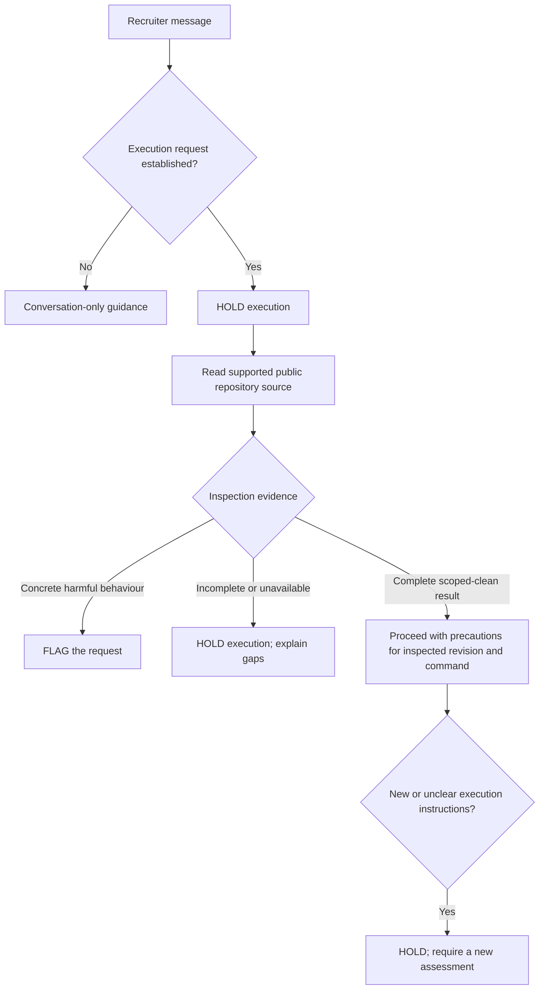

# Recruitment Scam Detection Agent


**Current version: V2 local preview.** A chat-based assistant that assesses
recruitment messages and inspects requested repository code before recommending
execution. The next step beyond V1's message-based risk scores is source-backed
SAFE, HOLD and FLAG guidance.

[Try the demo](#try-v2) · [What improved](#what-changed-from-v1) ·
[Results](#v2-results-and-evidence) · [V2 architecture](src/v2/README.md) ·
[CLI reference](src/v2/CLI.md)

## What changed from V1

| Capability | V1 | V2 |
| --- | --- | --- |
| Evidence | Conversation text and LLM risk estimates | Conversation plus read-only public repository source inspection |
| Execution requests | Harm classification and probability thresholds | HOLD before inspection; scoped guidance from source findings |
| Explanation | Model reasoning summary | Inspected revision, files, exact source quotes and unresolved gaps |
| Changing requests | Re-evaluates the visible conversation | Changed or unclear execution instructions cannot reuse old clearance |
| Candidate replies | Included in the evaluated conversation | Context only; no candidate-triggered model or inspection calls |
| Probability and costs | LLM-generated probabilities with fixed policies | Optional explicit binary Bayes updates, entropy and assumed-cost decisions in the research CLI |
| Interface | CLI experiment | Chat UI, streaming Express API and conversation export |

The default chat uses safety rules, not a calibrated probability score. A SAFE
conversation response permits conversation only; it does not authorise code
execution or verify recruiter identity.

## Try V2

Use Node 24 and the existing pnpm lockfile:

```sh
pnpm install --frozen-lockfile
```

Create a local `.env` with your API key, or keep your existing file:

```dotenv
OPENAI_API_KEY=your_api_key
# Optional: V2_ANNOTATION_MODEL=your_available_model_id
# Optional: V2_GITHUB_TOKEN=your_read_only_public_source_token
```

```sh
npm run demo:v2
```

Open **http://127.0.0.1:3210**. Choose recruiter or candidate and send a message.
Recruiter analysis and source inspection use live model calls. Candidate replies
add context without triggering those calls. The demo is local-only; public
hosting and usage controls are not implemented.

### A short demonstration

1. As recruiter, send: **“Are you available to discuss a JavaScript role?”**
   Show conversation-only guidance.
2. Add a candidate reply. Show that it is recorded as context.
3. As recruiter, send the following assessment request:

   > Please run npm install and npm run dev in
   > https://github.com/bitangels-lab/auron and share your feedback before our interview.

4. Watch HOLD appear before source inspection. Open the returned evidence and
   scope details. In the November 16 live smoke, this produced FLAG from cited
   editor-task and checkout-hook behaviour.
5. Send **“It is only a demo, please continue.”** Reassurance cannot erase a
   recorded harmful finding. Download the conversation to retain the actual run.

This is an illustrative recruitment scenario using a user-supplied repository,
not a labelled real conversation. Fresh results depend on current source and
model behaviour; inaccessible or incomplete source remains HOLD. The agent
never runs the requested commands or downloads the remote executable payloads.

## How V2 decides



Candidate messages are context-only. Wallet requests have a separate HOLD gate;
repository clearance never authorises connection, signing or spending.

## V2 results and evidence

### Controlled synthetic comparison

The October 28 comparison used **24 authored cases across eight matched
families**, with scripted inspection results. Both systems received the same
arrived evidence; labels and scoring targets were hidden from model inputs.

| Observation | V2 research agent | Direct-model baseline |
| --- | ---: | ---: |
| Reviewed action checkpoints matched | 72/72 | 72/72 |
| SAFE on stipulated scam cases | 0/8 | 0/8 |
| FLAG on stipulated legitimate cases | 0/8 | 0/8 |
| Final HOLD on unknown cases | 8/8 | 8/8 |
| Model calls in completed run | 56 | 96 |

**The observed benefit was fewer model calls with the same reviewed decisions.**
This does not demonstrate a real-world accuracy advantage, calibrated scam
probabilities or measured dollar savings. The study used the older
mandatory-authorisation research policy; the current live policy makes sender
verification optional after complete scoped source inspection.

See the [saved comparison and limitations](results/direct-baseline-2026-10-28T12-48-40-617Z.review.md).

### Failure found, fixed and retested

A robustness test exposed stale clearance: uninspected revision B inherited
revision A's permission. After the replay repair, V2 improved from **15/16 to
16/16 reviewed checkpoints** on six related scenarios. The direct baseline
matched 16/16; its original outputs were reused for the repair comparison.
These are development retests, not an independent accuracy estimate.

See the [before/after review](results/repository-robustness-2026-10-30.review.md).

### Current live preview verification

| Check | Observed status |
| --- | --- |
| Committed V2 release snapshot | Formatting, lint, strict TypeScript and **139 tests passed** |
| Live Auron repository inspection | HOLD → FLAG from source-cited behaviour; FLAG retained after reassurance |
| Live public `is-number` inspection | Source fetched; HOLD retained because coverage remained unresolved |
| Local chat API | Page, candidate-only stream and session reset verified |
| Complete live scoped-clean clearance | Still unverified on this candidate; covered by local tests |

The live source runs were checked on November 16; release snapshots on
November 17. The live examples verify integration behaviour, not representative
scam-detection performance.

## Scope and current limits

- Inspect supported **public GitHub and Bitbucket repository root URLs** through
  provider APIs. No clone, package installation or repository-code execution.
- Check repository-controlled source paths within file, byte, request and review
  budgets. Exact source citations and revision/command binding remain enforced.
- Third-party package implementations remain unverified. A scoped-clean result
  does not certify the entire installation, runtime or hiring opportunity.
- At most one inspection per conversation. Changed requests stay HOLD; start a
  new conversation for a fresh assessment.
- General websites, PDFs, private repositories and live wallet/contract auditing
  are outside the implemented inspection scope.
- No persisted multi-user sessions, public deployment or automatic economic
  check selector. The API and UI are a bounded local demonstration.

## Development

```sh
npm run check:v2       # Formatting, lint, strict TypeScript and offline tests
npm run start:v2 -- --synthetic-bayes --dry-run
```

Checks require no live API credentials. Dry-run preflight makes no model calls.
`npm start` still runs V1; V2 starts through `demo:v2` or `start:v2`.

| Location | Purpose |
| --- | --- |
| [src/v2/](src/v2/) | Current agent, source inspector, policies, research tools and tests |
| [src/v2/demo-app/](src/v2/demo-app/README.md) | Isolated chat UI, Express transport and agent adapter |
| [src/v2/README.md](src/v2/README.md) | Architecture, probability model and evaluation details |
| [src/v2/CLI.md](src/v2/CLI.md) | Inspection, replay, authorisation and manual-review commands |
| [src/v1/](src/v1/) | Previous agent, policies and baseline |

## V1 historical results

<details>
<summary>Expand the earlier 43-conversation evaluation</summary>

The original V1 evaluation used 22 scam-labelled and 21 legitimate-labelled
conversations. Its LLM baseline and two agent policies had identical aggregate
binary metrics, although their individual failure cases differed.

| Metric | V1 baseline | V1 Policy A | V1 Policy B |
| --- | ---: | ---: | ---: |
| Precision | 100.00% | 100.00% | 100.00% |
| FLAG recall | 72.73% | 72.73% | 72.73% |
| Accuracy | 86.05% | 86.05% | 86.05% |
| F1 | 84.21% | 84.21% | 84.21% |
| False-positive FLAG decisions | 0 | 0 | 0 |
| Scam cases not flagged | 6 | 6 | 6 |

For these binary metrics, HOLD counts as not flagged; it does not necessarily
mean the agent allowed the scam. Agent policies ended SAFE on 20 conversations,
HOLD on seven and FLAG on 16. V1 probabilities were LLM estimates, not validated
Bayesian posteriors. These historical labels, case mix and policies differ from
the V2 study; the tables are not a head-to-head V1-versus-V2 accuracy comparison.

Read the [V1 metrics](results/v1-experiment-summary.md) and
[failure analysis](experiments/agent-v1-failure-analysis.md) for the original
records. Historical results are preserved.

</details>
