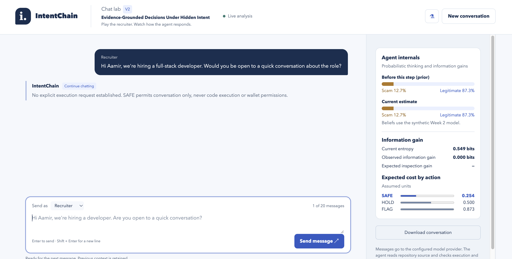
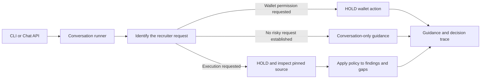

# IntentChain

**Evidence-Grounded Decisions Under Hidden Intent**

IntentChain is a recruitment risk assessment agent. It reads conversations one
message at a time and inspects supported public repositories when a candidate is
asked to run code. It returns **SAFE**, **HOLD**, or **FLAG** with the evidence
and scope behind the guidance.

[Quickstart](#quickstart) · [Architecture](#architecture) ·
[Security model](#security-model) · [Evaluation](#evaluation) ·
[Release status](#release-status)

## What IntentChain does

- **Tracks the conversation.** Recruiter messages trigger analysis. Candidate
  replies add context without making model or source calls.
- **Inspects requested code.** Public GitHub and Bitbucket source is read at a
  pinned revision. Findings cite the corresponding lines, and gaps explain
  what the review could not establish.
- **Keeps permissions scoped.** A completed review applies to the inspected
  revision and command. Changed or unclear instructions require reassessment.
- **Explains its decisions.** The research model exposes Bayes updates, entropy,
  expected inspection information gain, and the cost of each action. Model
  estimates use synthetic evidence rates and assumed costs.

## Quickstart

Requires Node.js 24, pnpm, and an API key for live analysis.

```sh
pnpm install --frozen-lockfile
```

Set `OPENAI_API_KEY` in a local `.env` file. Set `V2_ANNOTATION_MODEL` if you need
a different model identifier. An optional `V2_GITHUB_TOKEN` can be used for
read-only access to public GitHub source.

### Run the agent from the CLI

```sh
npm run start:v2 -- --conversation src/v2/demo-app/examples/public-source-smoke.json
```

The sample conversation exercises an execution request and a later change to
that request. The CLI writes a decision trace under `results/`. Add
`--dry-run` to validate the input without contacting the model or source provider.
For standalone repository inspection, replay, and manual review, see the
[CLI reference](src/v2/CLI.md).

### Try the Chat Lab

```sh
npm run demo:v2
```

Open **http://127.0.0.1:3210**. Use the experiment menu to load a recruiter
example, then review and send it. **Agent internals** shows the model’s belief
before and after each step, information gain, and expected decision costs.
Download the conversation to retain the trace, including inspection details.
See the [local API and Chat Lab guide](src/v2/demo-app/README.md).



## Architecture



The core runner owns sequencing and safety rules. Model calls identify requests
and review bounded source text. The inspection layer validates citations and
binds findings to the source revision and requested action. The CLI and Express
adapter expose the same core workflow.

The Chat Lab displays the numerical model alongside live guidance. The safety
policy controls the live recommendation and when inspection runs. In the CLI,
an explicit belief configuration can combine Bayes updates and expected costs
with the safety constraints. See the [V2 architecture and research model](src/v2/README.md).

## Security model

| What the agent sees | What it recommends |
| --- | --- |
| No risky request established | **SAFE** for conversation only |
| Inspection running, incomplete, or unavailable | **HOLD** execution |
| Concrete harmful behaviour with source evidence | **FLAG** the request. Later reassurance cannot clear the finding |
| Complete review with no harmful behaviour found within scope | **SAFE** with precautions for the inspected revision and command |
| Changed or unclear execution instructions | **HOLD** and require a fresh assessment |
| Wallet connection, signature, or approval request | **HOLD** the wallet action independently |

The source reader accepts supported public repository root URLs, applies path,
size, and request limits, and treats repository text as untrusted input. It
reads source through provider APIs without cloning, installing packages,
executing code, or downloading executable payloads. Messages and source excerpts
used for analysis are sent to the configured model provider.

The assessment covers repository-controlled paths within the review budget.
Third-party dependency implementations, private repositories, general websites,
PDFs and live wallet permissions are outside that scope. Conversation-only SAFE
provides no identity verification or execution permission.

## Evaluation

The controlled V2 comparison used **24 authored cases across eight matched
families**, with the same arrived evidence and scripted inspection results. V2
and the direct-model baseline each matched **72/72 reviewed action checkpoints**.
V2 made **56 model calls**, compared with **96** for the direct baseline. This
comparison measures behavior on the authored cases under the earlier research
policy, which required sender authorisation. See the
[saved comparison and study limits](results/direct-baseline-2026-10-28T12-48-40-617Z.review.md).

| Integration or regression | Observed result |
| --- | --- |
| Stale clearance replay | After the fix, **16/16** checkpoints matched, up from **15/16** on the same six scenarios. [Review](results/repository-robustness-2026-10-30.review.md) |
| Live harmful repository | HOLD became FLAG after source inspection. Reassurance preserved FLAG. |
| Live incomplete review | HOLD persisted while source coverage remained unresolved. |
| Live scoped review | The same pinned sample moved from unresolved to scoped SAFE after a source collection fix. A changed command returned to HOLD. [Before and after](src/v2/demo-app/examples/public-source-smoke.review.json) |

The live runs verify integration behavior. Broader detection accuracy and
probability calibration remain open evaluation questions.

## Release status

**V2 is available for local use through the CLI and loopback Chat API.** The
local server binds to `127.0.0.1`, uses in-memory sessions, and limits concurrent
analysis. Each conversation has an inspection budget of one repository. Start
a new conversation to assess a changed request.

Public hosting still needs an access policy, rate and spend limits, and
operational monitoring. Persistent multi-user sessions and automatic selection
among evidence checks are outside the current release.

## Development

```sh
npm run check:v2
npm run start:v2 -- --synthetic-bayes --dry-run
```

The V2 check runs formatting, lint, strict TypeScript, and local tests using
stubs. The replay dry run checks the fixture and makes no model calls.
`npm start` runs the archived V1 agent.

| Guide | Covers |
| --- | --- |
| [Agent architecture](src/v2/README.md) | Boundaries, numerical model, and evaluation protocols |
| [CLI reference](src/v2/CLI.md) | Inspection, replay, authorisation, and manual review |
| [Chat Lab API](src/v2/demo-app/README.md) | Streaming transport, local sessions, and setup |
| [V1 source](src/v1/) | Original message-based scoring agent and baseline |

Research title: *IntentChain: Sequential Evidence and Risk Assessment in Recruitment Conversations*

## V1 historical results

<details>
<summary>Expand the earlier 43-conversation evaluation</summary>

The original V1 evaluation used 22 scam-labelled and 21 legitimate-labelled
conversations. Its LLM baseline and two agent policies had identical aggregate
binary metrics, although their individual failure cases differed.

| Metric | V1 baseline | V1 Policy A | V1 Policy B |
| --- | ---: | ---: | ---: |
| Precision | 100.00% | 100.00% | 100.00% |
| FLAG recall | 72.73% | 72.73% | 72.73% |
| Accuracy | 86.05% | 86.05% | 86.05% |
| F1 | 84.21% | 84.21% | 84.21% |
| False-positive FLAG decisions | 0 | 0 | 0 |
| Scam cases not flagged | 6 | 6 | 6 |

For these binary metrics, HOLD counts as not flagged; it does not necessarily
mean the agent allowed the scam. Agent policies ended SAFE on 20 conversations,
HOLD on seven and FLAG on 16. V1 probabilities were LLM estimates, not validated
Bayesian posteriors. These historical labels, case mix and policies differ from
the V2 study; the tables are not a head-to-head V1-versus-V2 accuracy comparison.

Read the [V1 metrics](results/v1-experiment-summary.md) and
[failure analysis](experiments/agent-v1-failure-analysis.md) for the original
records. Historical results are preserved.

</details>
