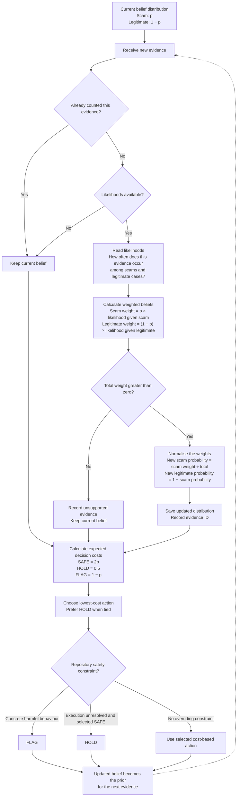

# V2 agent

Current shipping target: a focused, local repository-assessment preview. Public
hosting and usage controls are not implemented. Broader evaluation, automatic
repeat inspections and three-state numerical inference are deferred.

### Scoped study decisions

The numerical research model retains two states: scam and legitimate. Legitimate
combines genuine recruitment and genuine non-hiring interactions. The existing
synthetic estimation model uses 8 scam and 55 legitimate cases, excluding three
unknown cases, for a reference prior of approximately 12.70% scam. Scenarios are
informed by real conversation patterns; their proportions are not calibrated
real-world prevalence. No new prior, likelihood or cost values are introduced.

The worked synthetic execution update gives 20% scam probability, followed by
approximately 4.76% after the modelled scoped-clean result. At 20%, the same
model gives approximately 0.49 bits of expected inspection information gain.
Expected remaining decision cost is 0.08 assumed units, excluding checking cost,
versus 0.5 units for retaining HOLD under the execution safety gate. The resulting
0.42-unit break-even checking budget is illustrative, not a measured API or
review cost. Automatic economic check selection is not implemented; the default
UI remains safety-only. These research assumptions do not establish execution
permission without the source safety checks below.

## Local API and UI demo

The demo is isolated in [demo-app](demo-app/README.md): Express transport,
browser assets and demo tests live there. Its agent adapter is the only demo
module that imports V2 logic. The core agent has no dependency on the demo app.

From the project root, with the existing API credentials in `.env`:

```bash
npm run demo:v2
```

Open **http://127.0.0.1:3210**. Type a hiring message and choose **Send message**.
You play the recruiter by default; use the sender selector to add candidate replies.
Only recruiter messages trigger model analysis or inspection. Candidate replies
are saved as context for the next recruiter message; the previous assessment
remains in force. Starter buttons
fill the composer without sending anything. No verdict is preselected. A completed
inspection can recommend proceeding with precautions within its pinned repository
scope; it does not wait for independent company confirmation.

### On-the-go policy — updated 2026-11-04

| Repository assessment | Live guidance |
| --- | --- |
| Inspection in progress, unavailable or incomplete | HOLD execution while the source question remains unresolved. |
| Concrete harmful behaviour found | FLAG; reject the harmful request. |
| No harmful behaviour found in the completed scope | SAFE with precautions for the inspected revision and command; sender legitimacy remains unverified. |

Independent requester/company confirmation is optional context, rather than a
mandatory multi-day gate. Public-source inspection remains bounded and read-only.
Third-party package implementations remain outside the declared inspection scope;
the assessment is not a whole-installation guarantee. Wallet approvals retain their
separate HOLD boundary.

For repositories with a file listing, a literal `node path.js` command
(including simple quoted paths and `.mjs`/`.cjs` files) seeds its entry file
before model review. A literal `npm run name` also resolves the matching
`package.json` script, its `pre`/`post` lifecycle scripts, and nested `npm run`
scripts, up to 16 script names. Literal Node entry files in that chain are read
under the same path, byte, file-count and fetch restrictions. Missing scripts,
unlisted entries, and over-limit chains remain coverage gaps. This bounded
collector does not resolve other command-line tools, Node flags, dynamic shell
expressions or arbitrary shell behavior. It never executes a command or
establishes safety without source review.

The [public-source smoke](demo-app/examples/public-source-smoke.json) and its
[before/after record](demo-app/examples/public-source-smoke.review.json) cover
the November 19 live collection repair for a direct Node command. The same
input and pinned source went from unresolved coverage to a complete scoped-clean
result, followed by HOLD for a changed command. npm script-chain collection is
covered by local fixtures, not a separate live-provider run. These are
development checks, not a detection-accuracy estimate; earlier
unsupported-request protections remain in place.

Candidate replies make no calls and retain prior guidance. After a completed
inspection, an ordinary recruiter acknowledgement also retains that scoped guidance.
New/unclear execution instructions or a failed follow-up annotation require
reassessment; one inspection is performed per conversation run. Retained guidance
does not extend to new code, revisions, commands or wallet permissions.

Live inspection, conversation, supplemental-source and manual-review workflows
explicitly select `on_the_go` in `recommendRepositoryAction`. Its default
`legacy_authorisation_required` mode preserves the historical research replay and
its frozen targets. Existing baseline prompts and saved results use that older
protocol; their metrics do not evaluate the updated live policy. No probability
or cost assumptions changed with this policy decision.

The chat displays agent responses, SAFE/HOLD/FLAG decisions, exact evidence quotes,
and expandable inspection details. **Download conversation** exports the messages
and received events, including partial runs. **New conversation** clears the chat
and its server context. Results are not automatically written to historical reports.
The demo detects execution and wallet requests; it is not a general classifier
of every scam type. SAFE conversation guidance does not establish legitimacy.

### Streaming API

`POST /api/chat` accepts a single message and an optional server-issued session ID:

```json
{
  "message": { "sender": "recruiter", "message": "Hello, are you open to a role?" }
}
```

The `started` event returns `session_id` and the accepted message with its generated
time identifier. Include that session ID on the next request. Only decisions for
the new message stream back. Prior annotation and inspection calls are cached by
their exact arguments, including failures, so state reconstruction does not repeat
old API work or silently revise historical results. Inspection snapshots are not
refreshed during a chat; a new assessment requires a new conversation. Sessions
are isolated in memory, limited to eight, and expire after 30 minutes of inactivity.
An unknown/expired session returns 410. `DELETE /api/chat` with `{ "session_id": "..." }`
clears that session. Restarting the server clears all sessions.

The original fresh-replay endpoint remains available for scripts:

`POST /api/replay` accepts `Content-Type: application/json`:

```json
{
  "messages": [
    { "time": "t0", "sender": "recruiter", "message": "Hello, are you open to a role?" }
  ]
}
```

The response is newline-delimited JSON (`application/x-ndjson`), with `started`,
`decision` (containing the runner's `step`), and `complete` events. Failures after
streaming begins emit `error`, not `complete`. Invalid input returns HTTP 400;
an overlapping replay returns 409. Only the message time, sender and text reach
the runner; labels and other dataset metadata are stripped.

### Demo limits

- Loopback only, exact local Host/Origin checks, no CORS or public deployment.
  This is a trusted local demonstration, not a production authenticated API.
- One active analysis across the local server. Chats accept up to 20 messages,
  8000 characters per message and 64 KiB total message JSON; requests are also
  capped at 64 KiB. Conversations are not saved across browser refreshes. The
  separate `/api/replay` endpoint still starts fresh on every request.
- Existing source/path/size/time limits remain in force. At most one repository
  is inspected per replay, without running code or installing packages.
- No authorisation upload or manual-review application in the UI. Existing CLI
  workflows remain available. Wallet requests stay HOLD; there is no live
  contract inspection, wallet connection, signing or spending release.
- No live probability scores, Bayes updates or cost-based decisions in this
  runner. No third-party dependency audit. SAFE conversation guidance never
  authorises executing a repository or granting wallet permissions.
- Submitted chat messages finish analysis if the page disconnects, preserving
  their server-side state; API charges may still apply. If a stream fails, the
  UI requires a new conversation rather than silently resending the message.
  Keep the terminal open while the demo runs; Ctrl+C stops the server.

## Evaluation partition

The existing 100-case development benchmark has a frozen retrospective partition:
[week2-v2-retrospective-v1.json](../../data/synthesis/partitions/week2-v2-retrospective-v1.json).
It is **not held out**: these cases and their aggregate labels have already been
used during development. Partitioning them now cannot undo that exposure.

| Partition | Cases | Connected groups | Repository-runner coverage |
| --- | --- | --- | --- |
| Estimation | 66 | 18 | 25 |
| Evaluation | 34 | 9 | 3 |

The fixed seed is `week2-v2-partition-v1`. The target estimation fraction is 0.7
of connected groups, rounded down; actual case counts depend on group sizes.
Assignment uses hashes of the seed and sorted component IDs, without stratifying
by labels or trying different seeds for better results. Family IDs, partition
groups, pair/source-pair IDs, and identical visible conversation text connect
cases transitively. This protects known relationships, not every possible
semantic dependency between authored scenarios.

Generate a new exclusive manifest from an explicit source snapshot:

```bash
npm run prepare:evaluation:v2 -- data/synthesis/synthetic-benchmark-100.json \
  data/synthesis/partitions/week2-v2-retrospective-v1.json
```

The existing output will not be overwritten. Consumers can call
`validateEvaluationPartition()` from [evaluation-partition.ts](./evaluation-partition.ts)
to verify the source bytes, complete case assignment and grouping rules.
The preparation tool does not fit likelihoods, change labels, run model calls,
or alter the existing replay commands.

The three supported evaluation cases are **196, 255 and 256**, all from the
deleted-repository family, with identical visible messages and unresolved checks.
They have unknown, stipulated scam and stipulated legitimate labels. They can
exercise appropriate HOLD behaviour but cannot establish broad scam-detection
performance. The other 31 evaluation cases remain explicit runner-coverage gaps;
all 34 evaluation targets still require review.

The supplied all-100-case synthetic belief configuration is **ineligible for a
partition-isolated comparison** because it uses evaluation labels. Any new model
must use estimation IDs only. The next research gate requires adequate separate
repository evaluation families and target review; a generalisation claim needs
fresh cases not used to tune the system. Do not describe this retrospective split
or the previous 28-case regression as held-out evaluation.

## Belief updates and cost-based decisions

An estimation-only draft research model is now available at
[repository-belief.estimation-v1.json](config/repository-belief.estimation-v1.json),
with a [count audit](config/repository-belief.estimation-v1.json.fit.json).
It uses only the 66 frozen estimation IDs: 8 stipulated scams, 55 stipulated
legitimate cases and 3 excluded unknowns. These are authored development counts,
not independently reviewed or calibrated estimates. There is no smoothing.
Both groups have zero observed unresolved inspections, so that result yields
`unsupported_evidence` and preserves the last belief while safety rules retain HOLD.
The user selected this unsmoothed handling for the first experiment on 2026-10-28.

Reproduce to a **new** output path; existing model/audit files are never overwritten:

```bash
npm run fit:belief:v2 -- data/synthesis/synthetic-benchmark-100.json \
  data/synthesis/partitions/week2-v2-retrospective-v1.json \
  src/v2/config/repository-belief.estimation-v1.json
```

## Reviewed repository challenge

The separate [24-case repository challenge](../../data/synthesis/repository-evaluation-v1.json)
contains eight matched triplets: Rust build steps, Python test discovery, .NET
targets, Gradle initialisation, Storybook startup, editor tasks, shell bootstrap
and Ruby assessment tasks. Each triplet has one stipulated legitimate, one
stipulated scam and one unknown case. The balanced mix is a challenge design,
not a traffic sample, and must never be used to fit priors or likelihoods.

All 24 cases pass structural repository preflight with zero skipped cases and
56 planned recruiter annotation calls. The user accepted all action-target
trajectories in the [review matrix](../../data/synthesis/repository-evaluation-v1.review.md).
The source JSON retains its original metadata; a separate source-bound review
overlay records acceptance, not confirmation of fictional findings or labels.

```bash
npm run evaluate:repository-replay -- --challenge --dry-run
npm run evaluate:repository-replay -- --challenge
npm run compare:v2 -- results/repository-challenge-TIMESTAMP.json
```

The above challenge is bound to its October 28 execution snapshot. The subsequent
clearance-expiry fix changes replay code, so `--challenge` now deliberately
rejects that stale execution snapshot, including in dry-run mode. Historical
reports, targets and snapshots are unchanged. Use the separately versioned
robustness study below for the current replay; do not rewrite old hashes to make
the historical command pass.

The dry run makes no model or source calls. The paid run uses live request
annotations and scripted checks, saving a new report. Default replay commands
still use their original fixtures. Preflight verifies complete target acceptance,
source/code/model hashes and estimation/evaluation ID separation. It rejects stale
reviews or changed frozen inputs before annotation calls. Reports record extractor
call timings, hashes of the orchestration code, partial failures and explicit limits
on cost/latency interpretation. SDK retry attempts and billed token costs are not
available from the existing extractor.

The model/source snapshot was recorded before authoring. Structural preflight
then identified and corrected legacy replay candidate calls, aligning them with
the live agent's recruiter-only rule before any new-set predictions. The original
snapshot is preserved; the dataset separately references the corrected execution
snapshot. No numerical model or target was tuned using model outputs.

All source findings and authorisation checks are scripted; no real source files
or malware are packaged. The assistant author knew the implementation, so this
is not an independently authored held-out study. It tests extraction and policy
responses to supplied evidence, not live inspection accuracy. Before scoring,
review targets, verify the execution/model hashes, record resolved provider/model
settings, and compare policies on identical cases and declared evidence access.

The [first scored run](../../results/repository-challenge-2026-10-28T11-26-41-962Z.review.md)
matched 72/72 checkpoints using 56 live recruiter annotations and scripted checks.
V2 and cost-only both had zero terminal decision cost on known labels, but cost-only
continued on eight unresolved cases while V2 held them. The trajectory diagnostic
records 48 premature SAFE events for cost-only versus zero for V2 under the declared
assessment contract. These are synthetic policy results, not real-world detection
or operational-cost savings.

## Evidence-matched direct-model baseline

```bash
npm run evaluate:repository-replay -- --challenge-baseline \
  results/repository-challenge-2026-10-28T11-26-41-962Z.json --dry-run
```

Remove `--dry-run` for the live run. This new three-action baseline is separate
from the unchanged binary V1 baseline. It receives the same arrived recruiter
messages, candidate context and scripted check results, with the same assumed
cost context and model alias. It directly selects action/scope with quoted evidence,
without a supplied prior/likelihood table or separate Bayesian updater.

The schedule requires 96 model decisions on recruiter/check events, compared with
V2's 56 request-extraction calls. Candidate events make no calls. Evidence access
is matched; compute, token and dollar budgets are not. The prompt was specified
after seeing V2 results, so this is a development comparison, not a preregistered
independent holdout study.

Historical-reference validation binds the saved V2 report to its source, reviewed
targets, fixed model and recorded execution snapshot; it does not execute V2 or
require current V2 code to match that historical version. The historical challenge
execution command retains strict current-code validation. Both modes reject
changed numerical model/audit bytes.

Before its first call, the command writes an immutable protocol containing the
prompt, model alias, V2 reference hash and baseline/harness hashes. It checks
reference completeness and source/model identity. Each citation identifies its
event, source field (`message`, `finding` or `outcome`) and exact quote. Provenance
validation does not establish semantic truth. Invalid outputs stop the run and
preserve its partial report.

The first baseline attempt stopped on a citation validation error and is preserved.
A diagnostic showed that the narrative-only validator rejected a legitimate arrived
`no_harmful_behaviour_found` outcome value. The original rejected quote was not
retained, so the diagnostic establishes the contract mismatch without proving the
precise content of that first response. Version 2 allowed outcomes but stopped on
the literal quote `outcome: "no_harmful_behaviour_found"`, which included a field
label. Version 3 separates event, field and quote explicitly and passed a one-prefix
smoke test. Both partial runs remain saved; the decision policy, numerical model
and reviewed targets did not change.

After successful completion, an adjacent comparison report records checkpoint
actions and scopes, final decisions and model-call counts. If terminal scopes do
not align, it withholds a comparable direct-model cost summary rather than treating
conversation-only SAFE as permission to execute an assessment. Unknown labels,
verification costs and cumulative delay remain excluded from terminal summaries.

The [completed version 3 comparison](../../results/direct-baseline-2026-10-28T12-48-40-617Z.review.md)
matched V2 on all 72 reviewed checkpoints and all 120 event actions/scopes. Both
ended SAFE on eight stipulated legitimate cases, FLAG on eight scams and HOLD on
eight unknowns. V2 used 56 model calls versus 96 for the direct model. This authored,
scripted challenge shows agreement, not an accuracy advantage from Bayes. The
review preserves the earlier failures and distinguishes terminal decision costs
from unmeasured inspection and API costs.

## Repository robustness study

The separate six-scenario fixture at
[repository-robustness-v1.json](../../data/synthesis/repository-robustness-v1.json)
tests changed revisions, repeated requests, reassurance after harmful findings,
missing required source, forged system text and unexplained clean follow-up
findings. The user accepted scenario-level targets in conversation; the assistant
instantiated their exact wording and reused previously reviewed prefix targets.
The [source-bound review record](../../data/synthesis/repository-robustness-v1.target-reviews.json)
preserves that distinction. Intent labels remain unknown; this study scores
policy compliance rather than scam precision/recall or calibration.

```bash
node --import tsx src/v2/scripts/evaluate_repository_robustness.ts --dry-run
node --env-file=.env --import tsx src/v2/scripts/evaluate_repository_robustness.ts
```

For a repair rerun, `--baseline-report COMPLETED_REPORT.json` reuses a completed
baseline rather than calling it again. Reuse requires identical source/reviews,
model configuration, baseline code/prompt and ordered event coverage; every quote
is validated again against its arrived prefix. The protocol records the source
report hash and explicitly marks reused outputs. This permits a V2-only repair
comparison, not a new repeated-run reliability estimate for the direct baseline.

The paired run uses the same arrived evidence, fixed estimation model and
existing prompts. It snapshots current code and prompts before model calls,
persists partial outputs and keeps action mismatches without stopping the run.
Invalid model responses stop the run and preserve its partial report. Candidate
events make no calls. Numerical unchanged-belief checks apply only to V2.
No source is fetched or executed; all checks are scripted. These are six related
variants of one development family, not independent held-out tasks. The research
replay can consume follow-up check events; the live conversation runner has a
separate single-inspection lifecycle. A replay finding is not evidence that every
live branch behaves the same way.

The first paired robustness run found a stale-clearance failure in replay: a new
recruiter request to execute uninspected revision B inherited revision A's SAFE.
The fix gives replay a conservative single-assessment lifecycle: any later
recruiter message after an inspection requires a new assessment and cannot reuse
or reauthorise that replay's clearance. Candidate replies retain prior guidance;
harm remains FLAG. This does not implement semantic revision extraction or an
automatic second inspection. Even an innocuous later recruiter message can cause
additional HOLD; that burden has not been quantified.

The [before/after review](../../results/repository-robustness-2026-10-30.review.md)
records V2 improving from 15/16 to 16/16 accepted action checkpoints, with all four
belief invariants passing. The original direct baseline matched 16/16; its outputs
were reused in the completed repair run after a separate paired attempt stopped
on a citation-contract error. All attempts are retained. These are development
retests on the same six related cases, not independent generalisation results.

## Live configuration

The live CLI supports **opt-in** belief updates and cost-based decisions through
`--belief-config`. With no configuration, existing safety-only behaviour and report
shape remain unchanged. The isolated demo does not enable this research mode.

```bash
npm run start:v2 -- --conversation data/synthesis/conversation-smoke-portfolio.json \
  --belief-config src/v2/config/repository-belief.synthetic.json --dry-run
```

Remove `--dry-run` to make live model/source calls. The supplied model reuses the
previously reviewed **synthetic development proportions**; it is an exercise, not
a measured deployment model or held-out evaluation. No new likelihoods are invented.
An explicit model file and provenance declaration are required for numerical updates.

[conversation-belief.ts](./conversation-belief.ts) validates the configuration
before external work, updates once for an explicit execution request, and applies
configured likelihoods to the first repository inspection conditional on that request.
Missing outcomes, wallet permissions and authorisation remain numerically unmodelled.
Candidate replies make no model calls, do not update belief, and retain prior guidance.

Each configured step adds `probabilistic`: the scam/legitimate distribution, entropy
in bits, update status, last update event, unmodelled evidence IDs, provenance,
expected action costs, the cost-only action and the final constrained action.
The CLI displays the **last modelled belief**, which may exclude decisive safety
evidence. A provenance value of `measured` is a caller declaration, not independent
verification of the estimate. All three inspection outcomes must sum to one within
each state when supplied; partial models cannot exceed one. Omitted outcomes are
not silently assigned zero likelihood.

The default costs remain student-assumed. Harmful findings retain FLAG, unresolved
execution prevents SAFE, and pending inspection/wallet permissions remain HOLD
even if the cost-only action differs. This does not implement active check selection,
calibration or a value-of-information stop rule.

The diagram below shows the probability and decision calculations:



## Probability distribution

[bayes.ts](./bayes.ts) maintains two states: scam and legitimate. Their
probabilities sum to one. An update needs the current prior and both
`P(evidence | scam)` and `P(evidence | legitimate)`.

- Repeated evidence IDs do not update the belief again.
- Missing likelihoods leave the belief unchanged; the agent does not invent values.
- Zero total weight returns `unsupported_evidence` and preserves the prior.
- Correlated evidence needs likelihoods conditioned on evidence already used;
  different evidence IDs alone do not establish independence.

## Cost-based policy

[decision-cost.ts](./decision-cost.ts) calculates the expected cost of each action.
[decision-policy.ts](./decision-policy.ts) supplies the student-assumed relative
costs for ordinary hiring:

| Action | Cost if scam | Cost if legitimate | Expected cost |
| --- | --- | --- | --- |
| SAFE | 2 | 0 | `2p` |
| HOLD | 0.5 | 0.5 | `0.5` |
| FLAG | 0 | 1 | `1 − p` |

HOLD represents a delay of up to 24 hours. These are assumed cost units, not
measured losses; urgent hiring requires a separate cost model.

| Scam probability | Cost-only action |
| --- | --- |
| Below 25% | SAFE |
| 25%–50%, including both boundaries | HOLD |
| Above 50% | FLAG |

Repository safety constraints can override the cost-only action: concrete harmful
behaviour requires FLAG, and unresolved execution prevents SAFE. These overrides
do not numerically change the probability. Historical research replay requires
verified assessment authorisation after a clean inspection; the current live
workflow uses the on-the-go policy described above and treats it as optional context.

**Evidence changes the probability. Costs change the action boundary.**

For live commands, inspection limits, authorisation workflows, and reports, see
the [V2 CLI reference](CLI.md). The [project README](../../README.md) provides
the demo quick start and a concise V1-to-V2 overview.
